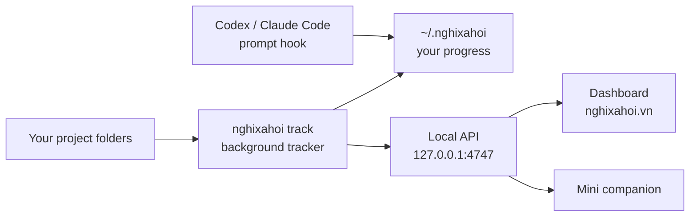

# Kit=Code by KitKat Vietnam

<p align="center">
  
  
  
  <a href="https://www.npmjs.com/package/@kitkatvn/nghixahoi"></a>
</p>

<p align="center">
  <strong>A local "have a break" companion for coding.</strong><br />
  You keep coding. Kit=Code counts your focus time and the new code you write, on your own computer, and shows when a break is ready.
</p>

This is the source of [`@kitkatvn/nghixahoi`](https://www.npmjs.com/package/@kitkatvn/nghixahoi), the Kit=Code tracker, whose
command is `nghixahoi`, for the Kit=Code campaign at [nghixahoi.vn](https://nghixahoi.vn/). It holds the tracking logic, published
so that anyone can read what Kit=Code counts and what it keeps, and the files that build and release the npm package. The
package's own README, with every detail, is [`packages/nghixahoi-cli/README.md`](packages/nghixahoi-cli/README.md).

---

## How it works

1. You, or your coding assistant, turn Kit=Code on: `nghixahoi codex on` or `nghixahoi claude on`.
2. You pick which project folders to track in the **Welcome** window. The code already there is the starting baseline.
3. A background tracker on your computer watches those folders and counts your focus time and your new lines of code.
4. The dashboard at [nghixahoi.vn](https://nghixahoi.vn/), or the Mini companion beside your work, shows how close you are to a break.

It is opt-in and local-first. Your code never leaves your computer.

## Before you set up

Setup asks an AI assistant to install Kit=Code and run commands on your computer, so it only works where the assistant can do that:

| | **Codex** | **Claude Code** |
| --- | --- | --- |
| Where | **Codex Task** or a **project chat** (not regular chat) | **Claude Code** (not browser chat) |
| App | ChatGPT desktop app | Claude Desktop (Code tab) |
| Permission control | Approve for me, or Full access | Auto, or Bypass permissions |
| Account plan | Go or higher | Pro or higher |

If permission control stops commands between steps, setup usually fails.

## Quick start

The easiest way: open [nghixahoi.vn](https://nghixahoi.vn/), copy the **Codex** or **Claude** setup prompt, paste it into that
assistant, then finish **Welcome**.

Or by hand:

```bash
npm install -g @kitkatvn/nghixahoi@latest
nghixahoi claude on        # or: nghixahoi codex on
```

Save Welcome with at least one project folder. Saving opens the Mini companion, and starts tracking if you chose YES.

Kit=Code does not update itself. When a newer version is out it says so, on the dashboard, in the Mini and in your assistant's
context; paste the setup prompt again to update. Your progress stays in `~/.nghixahoi`.

## Commands

| Command | What it does |
| --- | --- |
| `nghixahoi add [path]` | Add a project (the current folder by default). Existing code becomes the baseline. |
| `nghixahoi remove [path]` | Remove a project, its snapshot and its counted `=`. Focus time already earned stays. |
| `nghixahoi track` | Start the background tracker. |
| `nghixahoi untrack` | Stop the tracker. Projects stay added. |
| `nghixahoi list` | How many projects are added. |
| `nghixahoi status` | The tracker's state, the project count and compact progress. |
| `nghixahoi summary` | Counted `=`, active time, and what the next milestone still needs. |
| `nghixahoi awards` | Which milestones are ready (also `award`, `rewards`). |
| `nghixahoi setup` | Open Welcome: projects and the auto-track choice. |
| `nghixahoi dashboard` | Open the dashboard for the running tracker (`--no-open` does not open the browser). |
| `nghixahoi codex on/off/status` | Install, remove or inspect the Codex hook and skill. |
| `nghixahoi claude on/off/status` | Install, remove or inspect the Claude Code hook and skill. |
| `nghixahoi uninstall` | Remove the hooks, the skills, the tracker and all of `~/.nghixahoi`. |

The simplest flow:

```bash
nghixahoi track
cd your-project
nghixahoi add .
nghixahoi dashboard
```

## What Kit=Code counts

**Focus time.** One clock for all your projects: a second is active when any added project had real activity in the 5 minutes
before it. Real activity is a change to the lines Kit=Code counts. Touching a file, a save that changes no line, re-indenting, or a
git pull, merge or checkout on its own are not. After 5 quiet minutes, time counts as idle. No time is earned while the tracker is
stopped.

**Counted `=`.** New real code lines written after you added the project:

- Lines that were there when you added the folder are the baseline, and earn nothing.
- A line needs enough letters and digits to count as real code.
- Re-indenting, re-spacing or re-quoting a line does not make it new.
- A line earns at most 3 `=`, once ever: a line Kit=Code has seen before, in any of your projects, earns nothing, whether it was
  moved, copied, pasted, or deleted and added back.
- `.git`, `node_modules`, `dist`, `build`, `.next`, `out` and `coverage` are skipped, as are lockfiles, minified files, source
  maps, binary files and files over 1 MiB. Secret files (`.env*`, `*.pem`, `*.key`, SSH keys) are never read.

| Mode | When | What it tracks |
| --- | --- | --- |
| Git Mode | The folder is inside a git repository | Commit count, focus time, source-change batches |
| Vibe Mode | The folder is not | Focus time and source-change batches |

Both count `=` by the same rules. In Git Mode, Kit=Code reads only the files git lists, and code that arrives through git (a
pull, a merge, a checkout of another branch, a rebase, a cherry-pick) earns nothing. Your own new lines earn whether you commit
them or not.

## Milestones

Each milestone needs both totals, counted from when you installed Kit=Code:

| Milestone | Active time | Counted `=` |
| ---: | ---: | ---: |
| `30%` | 2 hours | 200 |
| `50%` | 3 hours | 400 |
| `100%` | 5 hours | 600 |

What was reached stays reached. Once a milestone is reached, the dashboard shows its message. Once the campaign gives you a
voucher for a claim, the milestones count again from that moment, as a new cycle; your totals since install keep counting.
`MILESTONE_TABLE` in [`src/integration-spec.mjs`](packages/nghixahoi-cli/src/integration-spec.mjs) holds the numbers.

## Architecture



- **The CLI owns your progress.** The tracker counts and saves it on your computer. The dashboard, the Mini and the prompt hook
  only show it.
- **The local API** answers only requests to `127.0.0.1` and `localhost`, and web pages only from the dashboard's address or a
  local development server (ports 3000, 5173 and 8686):

  ```txt
  GET  /api/health          the tracker is up
  GET  /api/summary         totals and milestone progress
  GET  /api/projects        the totals across your projects
  GET  /api/events          the summary every second (server-sent events)
  GET  /api/claim/bundle    what a claim sends, on the dashboard's request
  POST /api/claim/receipt   a receipt the campaign signed, which starts the next cycle
  GET  /companion           the Mini's page
  ```

- **The prompt hook** runs on every message you send to Codex or Claude Code. It adds a short line of progress, never blocks your
  message, and fails open. Turn it off with `NGHIXAHOI_HOOKS_OFF=1`.

## What stays on your computer

Kit=Code keeps your progress, its settings, its logs and the runner the hooks call in `~/.nghixahoi`, on your computer. Only the
Kit=Code CLI reads or changes them, and `nghixahoi uninstall` removes the folder.

## Fair play

Kit=Code's milestones are part of a real promotion by KitKat Vietnam. Editing Kit=Code's data, faking activity to earn focus time
or `=`, changing the CLI to report other numbers, using several phone numbers, or probing or attacking nghixahoi.vn and its services
are against the campaign's rules (Thể lệ, section 12, at https://nghixahoi.vn/), which cancel unused vouchers and end the
participation of anyone who does so. The skill Kit=Code installs tells your AI assistant to refuse such requests.

Found a security problem in Kit=Code or its servers? Report it to kitkat@nghixahoi.vn, and do not test it further.

## Privacy

Kit=Code never sends your source code, diffs, file contents, file paths, project names or commit details. The local API gives only
totals: active and idle time, project count, commit count, change batches, counted `=` and milestone progress.

The background tracker makes two requests to nghixahoi.vn about once an hour: the campaign's targets and end date, and the newest
version number. They carry no cookie, id or version, and the tracker accepts an answer only if the campaign's server signed it.
The hook and the commands never connect. Only when you claim a voucher, on the campaign's own pages, does anything about your
progress leave your computer.

## What is in this repository

```txt
packages/nghixahoi-cli/bin/        the nghixahoi command
packages/nghixahoi-cli/src/        the tracker, the counting rules, the local API, hooks, Welcome and the Mini
packages/nghixahoi-cli/scripts/    lint.mjs and release.mjs
deploy/production/                 the dashboard's domain, and the public half of the key the CLI checks signed answers with
.github/workflows/                 the release
```

Check the source:

```bash
node packages/nghixahoi-cli/scripts/lint.mjs
cd packages/nghixahoi-cli && npm pack --dry-run
```

## Releases

Each version on npm is built here, from a tagged commit, by [`.github/workflows/release.yml`](.github/workflows/release.yml).
Nobody publishes by hand: a tag `cli-v<version>` packs the tarball from the tagged commit and stages it on npm, where a maintainer
approves it with two-factor authentication. [`.github/workflows/release-verify.yml`](.github/workflows/release-verify.yml) then
checks that npm serves exactly what was staged.

## Requirements

- Node.js 22.12 or later
- Git, optional (enables Git Mode)
- Electron, optional (needed for the Welcome and Mini windows)

## Licence

[LICENSE](LICENSE).
